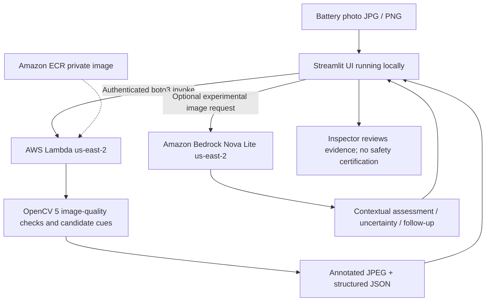

# BatteryGuard Vision - Architecture

**Implemented:** Streamlit, private Lambda container, ECR, OpenCV 5, optional Bedrock call. **Not implemented:** COOL/Graviton, MCP, fully autonomous agent/tool loop, public production endpoint, validated battery diagnosis.
