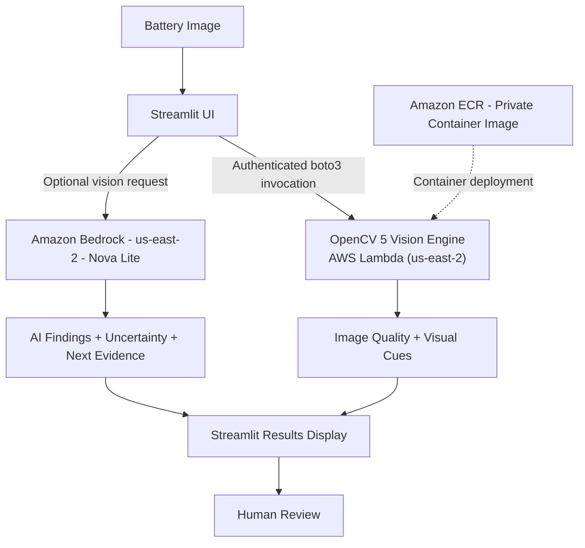

# BatteryGuard Vision - System Architecture

## 1. Overview

BatteryGuard Vision is an AI-assisted visual battery inspection prototype built using **OpenCV 5, AWS Lambda, Amazon ECR, Amazon Bedrock Nova Lite, Python, and Streamlit**.

The application combines traditional computer vision with contextual AI analysis to support preliminary battery inspections.

Its architecture separates image processing, contextual interpretation, and human review to provide explainable visual evidence without making definitive battery safety claims.

## 2. Architecture Diagram

**Architecture note:** BatteryGuard Vision supports local and cloud-based image processing.

In **Local OpenCV** mode, image analysis runs directly on the user's computer without invoking AWS services.

In **AWS Lambda** mode, OpenCV 5 runs inside a containerized Lambda function. When **Bedrock Vision** is enabled, Streamlit separately invokes Amazon Bedrock Nova Lite for contextual assessment.

The OpenCV and Bedrock outputs are displayed together but are not automatically reconciled into a single verified defect classification.

## 3. Core Components

### 3.1 Streamlit Web Interface

**Technology:** Python, Streamlit

The application provides:

- JPG and PNG image uploading.
- Selection between local and cloud processing.
- Display of original and annotated images.
- Image-quality information and visual candidate regions.
- Bedrock contextual findings, where enabled.
- Inspection recommendations and structured results.

The Streamlit application currently runs locally and communicates with AWS using authenticated boto3 requests.

### 3.2 OpenCV 5 Image Processing

**Technology:** OpenCV 5, NumPy, Python

OpenCV 5 performs the primary image-processing operations, including:

- Image decoding and resolution checks.
- Blur estimation using Laplacian variance.
- Brightness and exposure assessment.
- HSV color segmentation for amber and brown regions.
- Morphological analysis for narrow surface-line candidates.
- Texture analysis for pale granular residue candidates.
- Contour extraction and candidate region annotation.

The results consist of image-quality measurements, visual candidate regions, an annotated image, and structured JSON findings.

**Important:** OpenCV's highlighted regions are heuristic visual candidates. They are not confirmed battery defects, and the algorithms have not been validated as reliable battery-specific classifiers.

### 3.3 AWS Lambda

**Technology:** AWS Lambda, Python container runtime

**Deployment region:** `us-east-2` (Ohio)

**Function name:** `batteryguard-vision-api` (configurable)

The image-processing engine is packaged as a container image and deployed to AWS Lambda.

Streamlit invokes the private Lambda function using authenticated AWS SDK requests. Lambda processes the submitted photograph with OpenCV 5 and returns the analysis results.

The Lambda function does not independently invoke Amazon Bedrock.

### 3.4 Amazon Elastic Container Registry

**Technology:** Amazon ECR, Docker

Amazon ECR stores the private container image containing the OpenCV 5 processing engine and its required dependencies.

The deployment process involves:

1. Building a Linux-compatible container image.
2. Uploading the image to Amazon ECR.
3. Creating or updating the image-based AWS Lambda function.
4. Verifying the deployed function through test invocations.

Amazon ECR is part of the deployment architecture, not the runtime image-analysis request path.

Updating an existing image tag in ECR does not automatically update the deployed Lambda function.

### 3.5 Amazon Bedrock Nova Lite

**Technology:** Amazon Bedrock, Nova Lite, boto3 Converse API

Amazon Bedrock provides an optional second-stage contextual interpretation of the uploaded photograph.

The model evaluates visual evidence associated with potential:

- Leakage-like residue.
- Corrosion-like deposits.
- Casing damage.
- Possible deformation or swelling.
- Other visually supported abnormalities.

Model outputs include a potential finding category, visible supporting evidence, approximate location, uncertainty, and recommended next evidence when appropriate.

The application validates the structure of the model's responses and communicates uncertainty.

**Important:** Amazon Bedrock does not generate the OpenCV bounding boxes. Its conclusions are independent textual assessments and may contain errors.

### 3.6 Human Review

The final inspection interface presents visual candidate regions and contextual AI findings for human interpretation.

BatteryGuard Vision does not automatically certify batteries as safe, authorize continued operation, or prescribe handling procedures for potentially damaged batteries.

Where available evidence is insufficient, the system may recommend professional review or additional existing photographic evidence.

## 4. Processing Modes

| Mode | Processing location | Description |
|---|---|---|
| Local OpenCV | Local computer | Runs OpenCV analysis without AWS |
| AWS Lambda | AWS Lambda, us-east-2 | Runs OpenCV 5 in the cloud |
| AWS Lambda + Bedrock Vision | AWS Lambda and Amazon Bedrock | Combines cloud OpenCV analysis with contextual AI assessment |

The AWS Lambda and Bedrock calls are initiated by Streamlit. Amazon Bedrock is optional and requires appropriate service access and IAM permissions.

## 5. Inspection Workflow

1. The user uploads a battery photograph through Streamlit.
2. The user selects a processing mode.
3. OpenCV evaluates image quality and extracts candidate visual regions.
4. In AWS mode, the OpenCV analysis executes inside AWS Lambda.
5. If Bedrock Vision is enabled, Streamlit separately sends the image for contextual interpretation.
6. Streamlit displays the original photograph, annotated image, and available analysis results.
7. The user reviews the evidence and decides whether additional professional inspection is appropriate.

The application provides evidence-aware recommendations but does not currently implement an autonomous inspection agent or automated multi-step tool-orchestration loop.

## 6. AWS Configuration

The application supports the following environment variables:

| Environment variable | Default | Purpose |
|---|---|---|
| `BATTERYGUARD_AWS_REGION` | `us-east-2` | AWS deployment region |
| `BATTERYGUARD_AWS_PROFILE` | Optional | Named AWS credentials profile |
| `BATTERYGUARD_LAMBDA_FUNCTION` | `batteryguard-vision-api` | Lambda function name |
| `BATTERYGUARD_BEDROCK_MODEL_ID` | `amazon.nova-lite-v1:0` | Bedrock model identifier |

When no AWS profile is explicitly configured, boto3 uses its standard credential provider chain.

## 7. Security and Privacy

The prototype follows these basic security principles:

- AWS Lambda remains private and is invoked through authenticated AWS SDK requests.
- AWS permissions should follow least-privilege principles.
- AWS credentials and secret keys must never be committed to the repository.
- Public unauthenticated Lambda Function URLs are not enabled.
- Amazon Bedrock inference is optional and requires explicit selection of the relevant processing mode.

Photographs submitted for cloud processing are transmitted to the configured AWS services. The prototype is not presented as a formally audited privacy or data-retention system.

## 8. Evaluation and Known Limitations

BatteryGuard Vision has been tested on photographs representing different battery types and conditions, including alkaline cylindrical batteries, lithium-ion cells, lithium-polymer pouch batteries, visible deposits, and possible deformation.

Observed strengths include:

- Identifying some candidate regions that overlap visible corrosion-like or leakage-like deposits.
- Evaluating basic image quality.
- Providing contextual interpretations of some suspicious visual features.
- Distinguishing certain ordinary battery construction features from potential abnormalities.

Known limitations include:

- False positives from labels, protective tape, reflections, seams, and backgrounds.
- Missed abnormalities and incomplete contextual interpretations.
- Inconsistent recognition of swelling and punctures.
- No automatic spatial alignment between Bedrock findings and OpenCV bounding boxes.
- No established quantitative detection accuracy on a representative labeled dataset.
- No ability to determine hidden defects, internal battery conditions, or thermal hazards from a photograph.

The system is an experimental visual triage assistant, not a battery safety diagnostic tool.

## 9. Implemented and Future Capabilities

### Implemented

- Streamlit user interface.
- OpenCV 5 image-quality and visual-candidate processing.
- Private AWS Lambda deployment.
- Docker containerization and Amazon ECR integration.
- Optional Amazon Bedrock Nova Lite contextual analysis.
- Structured findings and inspection guidance.
- Local and AWS processing modes.

### Not Implemented

- COOL or AWS Graviton optimization.
- MCP integration.
- Fully autonomous agentic inspection orchestration.
- Multi-camera or real-time video analysis.
- Public production hosting.
- Trained battery-specific defect classification.
- Validated battery safety diagnosis.

### Potential Future Improvements

- Battery-specific trained detection models.
- Improved region localization and false-positive reduction.
- Multi-angle geometry analysis for deformation assessment.
- Agentic inspection workflows with explicit human approval.
- Batch processing for electronics recycling operations.
- Historical inspection comparison and audit logging.
- Edge-device deployment.

## 10. Responsible Use

BatteryGuard Vision is designed to support preliminary visual inspection and human decision-making.

Its findings must not be interpreted as confirmation that a battery is safe or defective. Visual evidence may be incomplete, and some hazardous battery conditions have no obvious external signs.

Users should not handle, puncture, charge, rotate, or disturb potentially damaged batteries solely to obtain additional photographs for the application.

**BatteryGuard Vision does not replace qualified battery inspection, applicable safety procedures, or professional judgment.**
